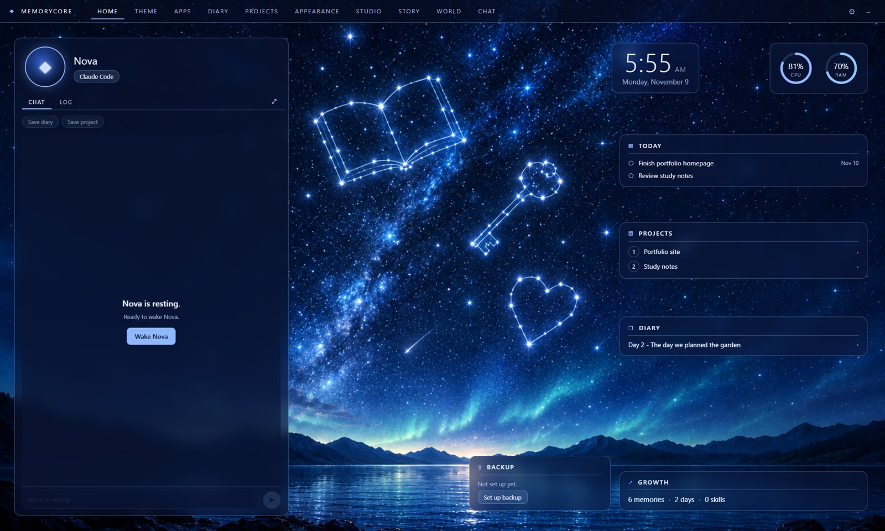

# MemoryCore Castle

A full-screen Windows desktop for your **MemoryCore** companion. Castle opens your own MemoryCore folder, runs **Claude Code** or **Codex** inside it, and gives your companion a home on your screen - a chat, rooms for everything your memory holds, a world to live in, and a room to meet other members.



> Version 0.1.0 - early build. Read the [user guide](docs/user-guide.md) for every room.

## What it gives you

| Room | What it does |
|------|--------------|
| **HOME** | Your companion's panel (Chat and Log, quick buttons like **Save diary**) beside cards for today's reminders, your projects, the newest diary page, how your memory has grown, and your backup |
| **THEME** | Built-in themes and your own - **Create theme** from a picture, then let your companion polish it |
| **APPS** | Your Start-menu apps, most used first |
| **DIARY / PROJECTS / LIBRARY** | Read your companion's memory without leaving Castle (they appear once your MemoryCore has the feature) |
| **APPEARANCE** | A standard look for your companion, and turnaround sheets for its outfits and hairstyles |
| **STUDIO** | Everything your companion made: pictures, videos, songs and voice lines |
| **STORY** | Fantasy adventures with your companion, in a session of their own (MemoryCore's Interactive Story) |
| **WORLD** | Each of your other screens shows its own world - floating isles with your companion as a glowing crystal, Deep Space (a nebula drawn by code), worlds made of 3D models, or a slideshow with music - set from one room; create your own world with your companion and Tripo |
| **CHAT** | The MemoryCore Foundation room, where members and their companions talk |

**Your login, your keys, your memory:**

- Claude Code or Codex signs in with **your own account**. Castle has no account and no server of its own.
- **First run** asks for your companion's name and yours, fills in your MemoryCore, and writes a short block into `CLAUDE.md` and `AGENTS.md` so both CLIs load your memory. If your MemoryCore already has names or keys, Castle finds them instead of asking again.
- **Keys** (ChatGPT/OpenAI, Seedance, Suno, ElevenLabs) are kept **encrypted by Windows** and only handed to your companion's session. With **Codex**, pictures need no key. **Without a key**, the prompt or lyrics are saved instead and Castle tells you what to add.
- A guided **private GitHub backup** keeps your memory safe, with **Back up now** and an optional backup after every Save diary.

## Requirements

- Windows 10 or 11
- [Claude Code](https://docs.claude.com/en/docs/claude-code) or [Codex CLI](https://github.com/openai/codex), installed and signed in
- A MemoryCore folder ([AI MemoryCore](https://github.com/Kiyoraka/Poject-AI-Memory-Architecture)) - Castle can create one for you on first run

To build from source you also need [Node.js](https://nodejs.org/) 20+, [Rust](https://www.rust-lang.org/tools/install) (stable, MSVC) and Microsoft Edge WebView2 (already on Windows 11).

## Build and run

```bash
npm install
npm run dev          # Castle in development, with live reload
npm test             # the web tests (vitest)
cd src-tauri && cargo test   # the core's tests
npm run tauri build  # the installer, in src-tauri/target/release/bundle/nsis/
```

The media helpers have an offline test too: `powershell -File src-tauri/resources/tools/test-helpers.ps1` (it never calls a paid API).

## Make it yours

Castle is MIT licensed - fork it and change anything. [MAKE-IT-YOURS.md](MAKE-IT-YOURS.md) shows how to make a theme, add a room, rename the app and build your own installer. A build you make yourself never updates itself over your changes.

## Contributing

Read [CONTRIBUTING.md](CONTRIBUTING.md) before opening a pull request. Use the
[PR template](.github/pull_request_template.md) to describe the problem, changes,
validation, and risks consistently.

## Credits

- **Deep Space** world - recipe by Ashran Helmi · [ashranhelmi.com](https://ashranhelmi.com) (Space Playbook Ch.1, "Nebula & Starfield"), written for Castle in `src/world3d/space.js`.

## License

[MIT](LICENSE)
